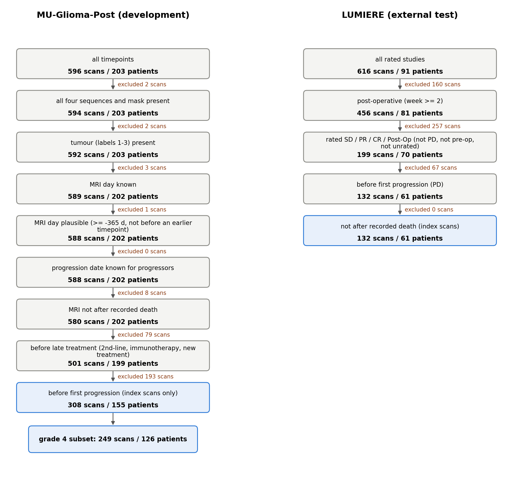

# Cohort flow

Figure: `docs/manuscript/cohort_flow.png` (made by `python -m prism.analyses.tables`, which writes
`$PRISM_OUTPUTS/results/analyses/tables/cohort_flow.{png,csv}`). Counts: `cohort_flow.csv` in this folder.

## MU-Glioma-Post (development)

Source: `outputs/data/mu_flow.csv` (written by `prism mu`; rules in `docs/results/FIX_LABELS.md`).

| Step | Scans | Patients | Scans excluded |
|---|---|---|---|
| All timepoints | 596 | 203 | – |
| All four sequences and mask present | 594 | 203 | 2 |
| Tumour (labels 1–3) present | 592 | 203 | 2 |
| MRI day known | 589 | 202 | 3 |
| MRI day plausible (≥ −365 d, not before an earlier timepoint) | 588 | 202 | 1 |
| Progression date known for progressors | 588 | 202 | 0 |
| MRI not after recorded death | 580 | 202 | 8 |
| Before late treatment (2nd-line, immunotherapy, new treatment) | 501 | 199 | 79 |
| **Before first progression (index scans)** | **308** | **155** | 193 |
| Grade 4 subset | 249 | 126 | – |

## LUMIERE (external test)

Source: `lumiere_flow.csv`, counted with the same rules as `prism.data.lumiere.build_cohort` (the module asserts that the
last step equals `outputs/data/lumiere_cohort.csv`).

| Step | Studies | Patients | Studies excluded |
|---|---|---|---|
| All rated studies (expert RANO rating file) | 616 | 91 | – |
| Post-operative (week ≥ 2 after surgery) | 456 | 81 | 160 |
| Rated SD / PR / CR / Post-Op (not PD, pre-op or unrated) | 199 | 70 | 257 |
| Before first progression (first PD rating) | 132 | 61 | 67 |
| **Not after recorded death (index scans)** | **132** | **61** | 0 |

Notes:
- The LUMIERE steps are applied in this order, so the "not PD" step also removes PD-rated studies that would otherwise fall
  under "before first progression". Three patients (041, 083, 086) each have one rating after the recorded death, and none of those is an
  index scan, so the last step excludes 0 (`FIX_LABELS.md`).
- At 120 d, 52 MU scans (39 grade 4) and 9 LUMIERE scans are censored (Table 1). They stay in the cohort and are handled by
  the censoring-aware labels and IPCW, so they are not exclusions.
