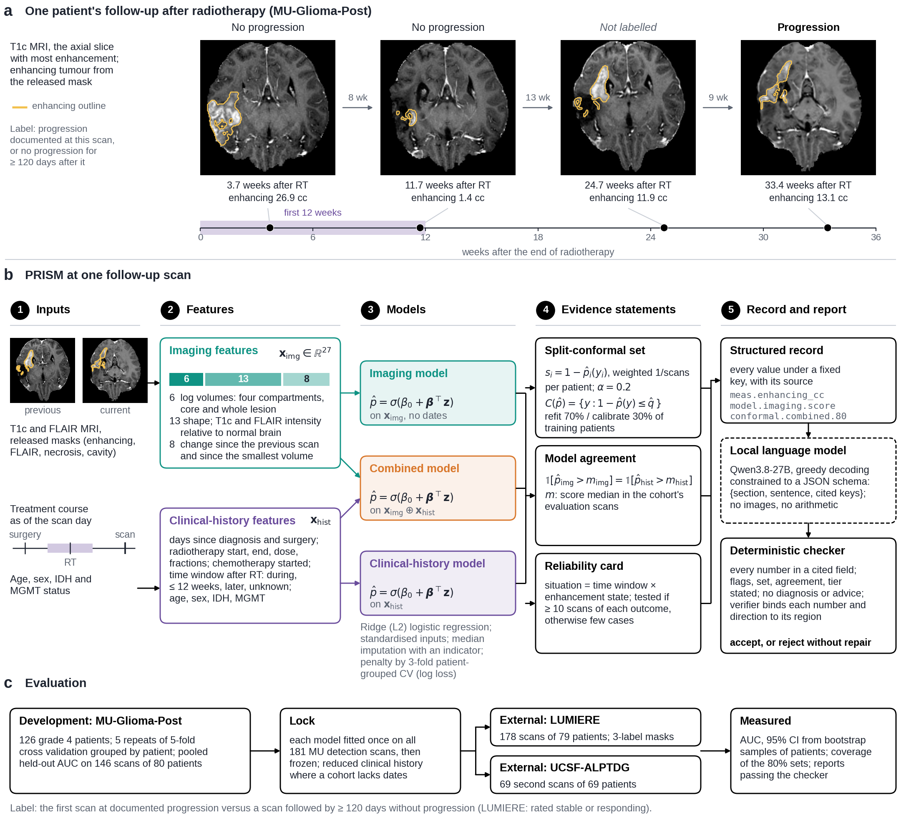
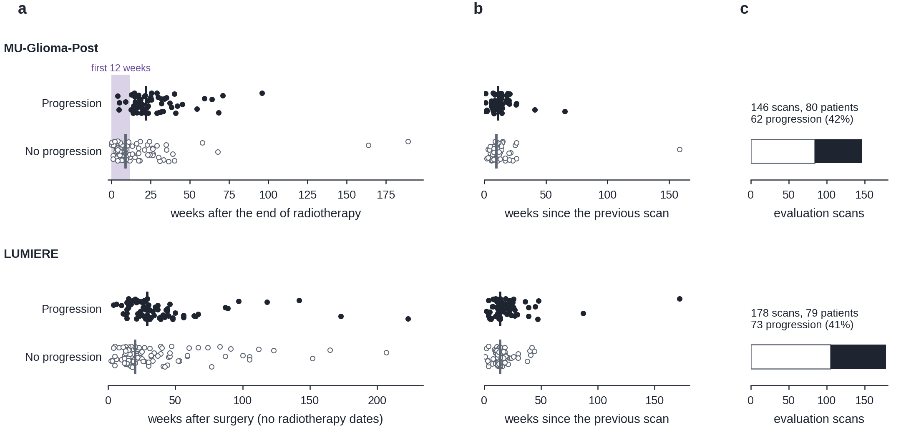
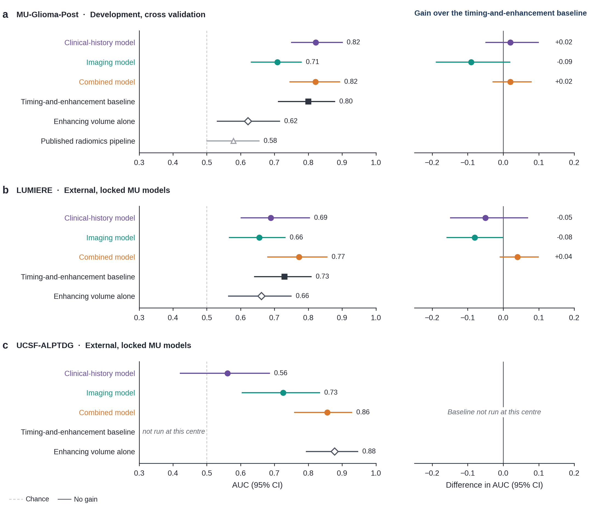
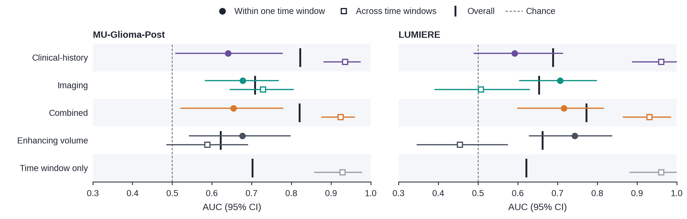
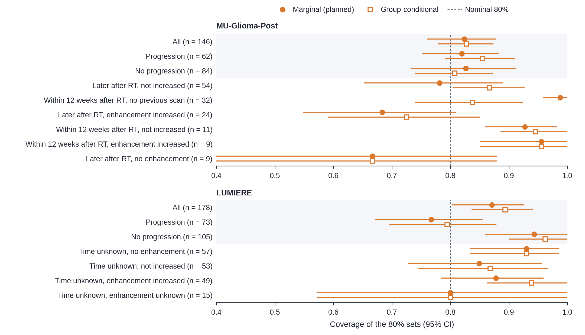
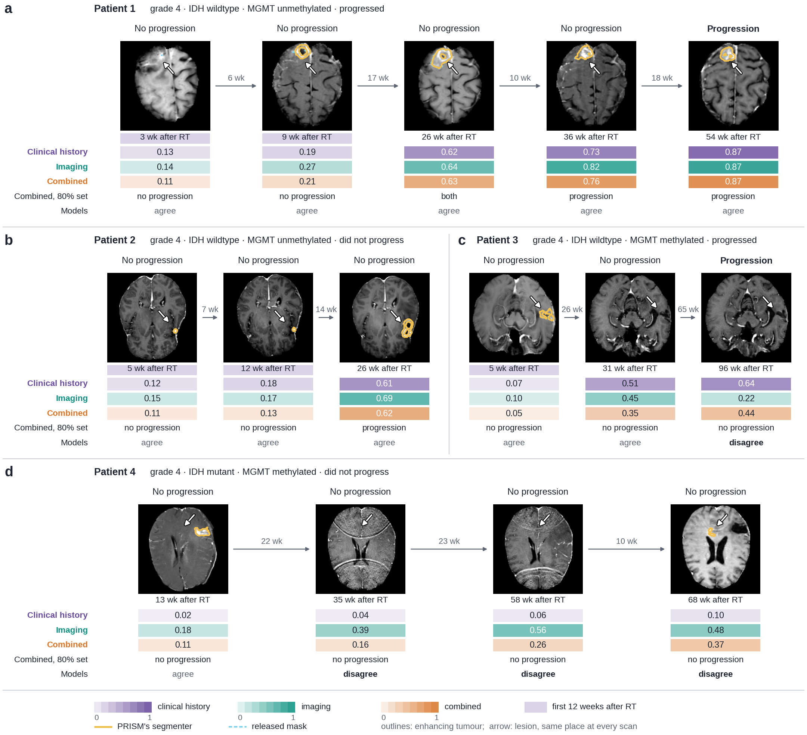
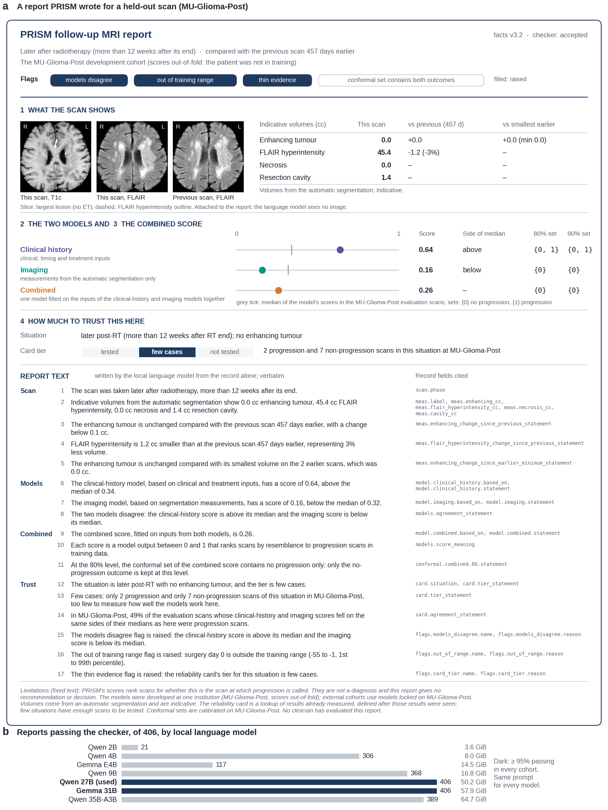

# Figure review (2026-11-19)

Every figure in `paper/main.tex`, in the paper's order and numbering. All are in the paper; `paper/main.pdf` is
rebuilt. Write comments under any figure and I will apply them.

---

## Figure 1: the task and the method (Section 2)

`scripts/fig1_prism.py`. (a) One MU patient's follow-up on real scans; (b) PRISM at one follow-up scan; (c) evaluation.

---

## Figure 2 (new): when the evaluation scans were taken (Section 3.1)

`scripts/fig_cohorts.py`, after Tak Fig 2. One row per cohort: (a) the time of each evaluation scan, by label;
(b) weeks since the previous scan; (c) scans and progression share. Bars mark medians.

- MU: median progression scan 22.0 weeks after radiotherapy, non-progression 8.9 weeks: the timing link is visible
  before any model.
- LUMIERE: 29 against 20 weeks after surgery (no radiotherapy dates).
- Counts match the paper (MU 146 / 80 / 62; LUMIERE 178 / 79 / 73).
- UCSF is not drawn: its data are not on orchard. The caption points to Table 1 for it.

---

## Figure 3: performance by cohort (Section 4.2)

`scripts/fig2_performance.py`, after Tak Fig 3. Both writing reviews flag "development centre" in its caption title.

---

## Figure 4: where the ranking comes from (Section 4.3)

---

## Figure 5: coverage within groups (Section 4.4)

---

## Figure 6 (new): four patients' follow-up (Section 4.4)

`scripts/fig_case_strips.py`, after Tak Fig 4. Patients chosen by a written rule (first in ID order with ≥ 3
evaluation scans): (A) progression, models agree; (B) no progression, agree; (C) progression, disagree at that scan;
(D) no progression, disagree. Scores out-of-fold, repeat 0.

---

## Figure 7 (redesigned): the report PRISM writes, and the check (Section 4.5)

`scripts/fig5_report.py`. Panel (a) is now a **real** report, not a synthetic one: the progression scan of strip C in
Figure 6 (PatientID_0029, held out from prompt development, accepted by the checker), laid out as a report page in
BT-RADS order. Research and reasoning: [REPORT_FORMAT_RESEARCH.md](REPORT_FORMAT_RESEARCH.md).

- Header: timing, comparison interval, flags as chips (filled = raised).
- Section 1: the report's own segmentation slices beside the volume table.
- Sections 2–3: each score as a dot against its cohort median, with the 80% and 90% sets.
- Section 4: the card tier as a three-state scale with the counts.
- The language model's 17 sentences verbatim, numbered, with the cited record fields in a column.
- Panel (b) unchanged in content, redrawn compact.

To decide
- [ ] Real report (as now) or back to a synthetic example?
- [ ] This scan has no enhancing tumour, so the images show FLAIR. A scan with visible enhancement would look more
      typical; PatientID_0029 was chosen because it links to Figure 6 and raises three flags.

